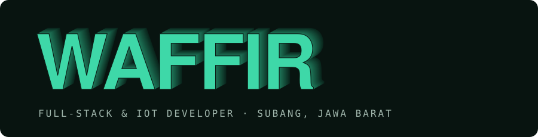
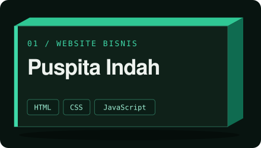
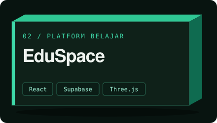
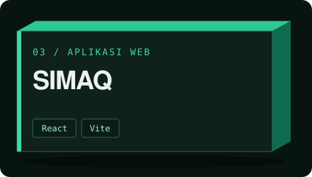
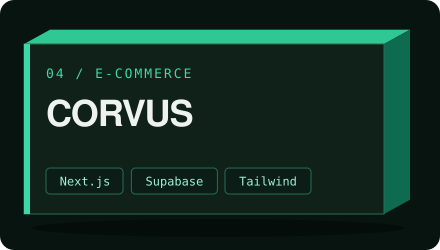
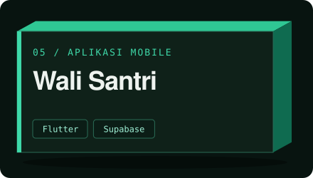
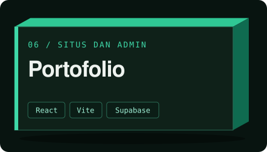

Full-Stack & IoT Developer dari Subang, Jawa Barat. Pelajar SMKIT Assyifa Boarding School, Ketua IT Club.

Saya membuat web app, aplikasi Flutter, dan alat IoT berbasis ESP32. Beberapa sudah dipakai sekolah dan klien. Sekarang terbuka untuk proyek lepas.

## Alat

## Aktivitas

## Proyek pilihan

<table>
  <tr>
    <td width="33%"></td>
    <td width="33%"></td>
    <td width="33%"></td>
  </tr>
  <tr>
    <td width="33%"></td>
    <td width="33%"></td>
    <td width="33%"></td>
  </tr>
</table>

Juga: [Batik Nusantara](https://batik-nusantara-01-72sh.vercel.app/Batik%20Nusantara.dc.html), platform budaya batik interaktif dengan studio membatik 3D.

## Kontak

Kirim kebutuhanmu lewat email atau portofolio di atas. Saya balas dan kita bahas detailnya.
